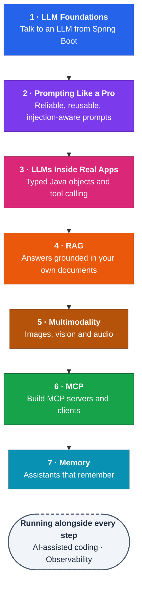

# Spring AI Masterclass: Course Roadmap & Objectives

**If you know Spring Boot, you're ready.** You don't need any AI or machine learning background. We start with
what an LLM is and our first `ChatClient` call, and climb, one step at a time, to MCP servers and AI applications
that remember.

## From First Prompt to AI That Remembers

| Step | Part | You'll be able to… | Code |
|---|---|---|---|
| 1 | [LLM Foundations](#step-1--llm-foundations) | explain how LLMs work and talk to one from Spring Boot | [`explore-openai`](explore-openai) |
| 2 | [Prompting Like a Pro](#step-2--prompting-like-a-pro) | write reliable, reusable, injection-aware prompts | [`explore-openai`](explore-openai) |
| 3 | [LLMs Inside Real Apps](#step-3--llms-inside-real-apps) | get typed Java objects back and let the model call your code | [`explore-openai`](explore-openai) |
| 4 | [RAG](#step-4--rag) | ground answers in your own documents | [`explore-rag`](explore-rag) |
| 5 | [Multimodality](#step-5--multimodality) | generate and understand images and audio | [`multimodal-llms`](multimodal-llms) |
| 6 | [MCP](#step-6--mcp) | build MCP servers and clients, and add MCP to an existing REST API | [`mcp`](mcp) |
| 7 | [Memory](#step-7--memory) | build assistants that remember within a conversation and across conversations | [`chat-memory`](chat-memory) |

---

## Step 1 — LLM Foundations

*Sections: Introduction to LLMs · Getting Started with Spring AI and OpenAI*

The world before ChatGPT, how LLMs evolved, and what they're good and bad at. Then your first Spring AI app.

By the end of this step you'll be able to:

- explain what an LLM is, how it evolved, and where it falls short
- call OpenAI from Spring Boot with `ChatClient`, and know what auto-configuration does for you behind the scenes
- explain prompts, tokens and tokenization, and tune `temperature` and `max_tokens`
- use **system**, **user** and **assistant** messages to shape a conversation
- stream responses as they're generated

## Step 2 — Prompting Like a Pro

*Sections: PromptTemplates · Spring AI Advisors · Prompt Engineering*

By the end of this step you'll be able to:

- build prompts with `Prompt`, `StringTemplate` and `PromptTemplate`, and pass dynamic values into them
- intercept and enhance every LLM call with **Advisors**, including `SimpleLoggerAdvisor` and one you build yourself
- apply **zero-shot**, **few-shot**, **chain-of-thought** and **multi-step** prompting
- recognise **prompt injection** and defend against it

## Step 3 — LLMs Inside Real Apps

*Sections: Structured Outputs · Tool Calling*

This is where an LLM stops being a chatbot and becomes part of your application.

By the end of this step you'll be able to:

- turn LLM answers into Java records, lists and maps with `entity()` and `BeanOutputConverter`, and explain how it
  works behind the scenes
- let the model **call your Java code** — system time, live currency rates, live weather — as functions or Spring
  beans
- control tool calls with `returnDirect` and `ToolContext`, and build a `ToolCallback` programmatically

## Step 4 — RAG

*Sections: RAG Concepts · Build a Q&A RAG App · Document Ingestion Strategies*

By the end of this step you'll be able to:

- explain why **prompt stuffing** doesn't scale and how Retrieval-Augmented Generation fixes it
- index documents into **PGVector** and retrieve the relevant chunks for a question
- build an end-to-end **index → retrieve → generate** Q&A app, and explain how embeddings are created
- ingest PDFs, Word documents and text files, chunking by page, paragraph or token

## Step 5 — Multimodality

*Sections: Image Generation · Vision · Audio · Local LLMs with Ollama*

By the end of this step you'll be able to:

- generate images from text and save them, controlling the options for each request
- have an LLM **look at an image**, from the file system or an upload, and extract invoice data from a photo
- turn text into speech, and speech into text
- run an LLM **on your own machine** with Ollama and switch to it through the same Spring AI API

## Step 6 — MCP

*Sections: MCP Fundamentals · Weather MCP Server · Currency Converter MCP Server · MCP Client (WebMVC) · MCP Client
(WebFlux) · REST API + MCP Server*

The Model Context Protocol is how AI applications plug into tools and data. We build **both sides**.

By the end of this step you'll be able to:

- explain the MCP architecture — host, client, server — and its transports (STDIO, HTTP, Streamable HTTP)
- build MCP servers on **WebMVC** and **WebFlux**, test them with **MCP Inspector**, and write integration tests
  with **WireMock**
- build MCP clients that connect **one LLM to many servers**, log every tool call, and choose between stateful and
  stateless connections
- add an MCP server to an **existing REST API** without changing it

## Step 7 — Memory

*Sections: Chat Memory · Long-Term Memory*

LLMs forget everything between calls. In this step you fix that.

By the end of this step you'll be able to:

- add conversation memory with `MessageChatMemoryAdvisor`, persist it in **Postgres**, and explain how the
  sliding window evicts old messages
- manage memory yourself with `ChatModel`, and recall past messages **by meaning** with a vector store
- build **long-term memory**:
  - **episodic** — what happened in past conversations
  - **semantic** — facts about the user
  - **procedural** — how the business handles a request, with a human in the loop
- see all of it working together in a chat UI

---

## Running alongside

These aren't steps on the path. They come along with you the whole way.

| Topic | You'll be able to… | Notes |
|---|---|---|
| **AI-assisted coding** | use GitHub Copilot and Claude Code as coding assistants in your daily workflow | [`docs/claude-code-setup.md`](docs/claude-code-setup.md) |
| **Observability** | see logs, metrics and traces for every LLM and tool call in Grafana, and add your own metrics with `MeterRegistry`, the Observation API and `@Observed` | [`docs/observability.md`](docs/observability.md), [`observability`](observability) |

## Appendix

**Foundations of Generative AI** — how LLMs are trained, and how the GPT models evolved. Optional reading for
anyone who wants more theory.
