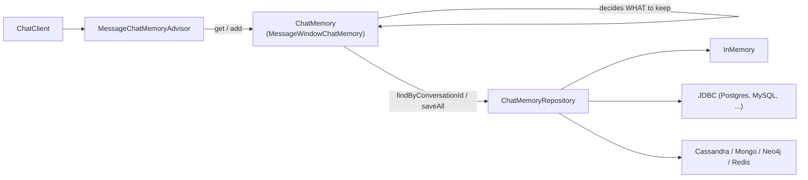
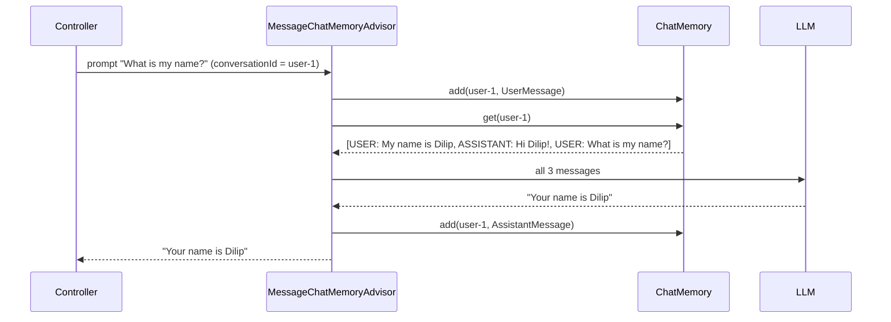

<!-- START doctoc generated TOC please keep comment here to allow auto update -->
<!-- DON'T EDIT THIS SECTION, INSTEAD RE-RUN doctoc TO UPDATE -->

- [Chat Memory in Spring AI](#chat-memory-in-spring-ai)
  - [Why Chat Memory?](#why-chat-memory)
    - [Chat Memory vs Chat History](#chat-memory-vs-chat-history)
  - [Core Abstractions](#core-abstractions)
    - [How the advisor works](#how-the-advisor-works)
  - [Conversation IDs](#conversation-ids)
  - [MessageWindowChatMemory](#messagewindowchatmemory)
  - [In-Memory Chat Memory](#in-memory-chat-memory)
    - [Setting up the controller](#setting-up-the-controller)
    - [Chat — `POST /v1/memory/chats/{conversationId}`](#chat--post-v1memorychatsconversationid)
    - [History — `GET /v1/memory/chats/{conversationId}`](#history--get-v1memorychatsconversationid)
    - [Clear — `DELETE /v1/memory/chats/{conversationId}`](#clear--delete-v1memorychatsconversationid)
  - [Persistent Chat Memory with JDBC (Postgres)](#persistent-chat-memory-with-jdbc-postgres)
    - [Dependency — `build.gradle`](#dependency--buildgradle)
    - [Configuration — `application.yml`](#configuration--applicationyml)
    - [The table](#the-table)
    - [Configuring it manually](#configuring-it-manually)
  - [Chat Memory with ChatModel (no advisor)](#chat-memory-with-chatmodel-no-advisor)
  - [Other Chat Memory Repositories](#other-chat-memory-repositories)
    - [VectorStoreChatMemoryAdvisor](#vectorstorechatmemoryadvisor)
  - [Limitations](#limitations)
  - [Migrating from older Spring AI versions](#migrating-from-older-spring-ai-versions)
  - [Running the module](#running-the-module)
    - [Endpoints](#endpoints)
    - [Try it](#try-it)
    - [Tests](#tests)

<!-- END doctoc generated TOC please keep comment here to allow auto update -->

# Chat Memory in Spring AI

> Reference: [Spring AI — Chat Memory](https://docs.spring.io/spring-ai/reference/api/chat-memory.html)

## Why Chat Memory?

LLMs are **stateless**. Every request is a brand-new conversation — the model has no idea what you said a second ago.

Try it with the stateless endpoint (`POST /v1/chats`, no memory):

```text
You : My name is Dilip
LLM : Nice to meet you, Dilip!

You : What is my name?
LLM : I don't know your name.   <-- the first message never reached the model
```

So how does ChatGPT appear to remember?

- "Remembering" is something **your application** does, not the model.
- Your app **stores** the previous messages of the conversation.
- On every new prompt, it **replays** those messages to the LLM along with the new one.
- The LLM re-reads the whole conversation each time and answers as if it remembered.
- Spring AI gives you all of this out of the box through the **Chat Memory** abstraction — you don't write the plumbing.

### Chat Memory vs Chat History

**Chat Memory**

- The information the LLM keeps so it's aware of context across the conversation.
- Only what's needed to answer the **next** prompt, not everything ever said.
- Bounded: older messages are dropped so every call stays within the model's context window, token budget, and latency limits.
- Sent to the LLM on **every** call, so its size directly affects cost.
- Managed by Spring AI's `ChatMemory` abstraction (e.g. `MessageWindowChatMemory`).

**Chat History**

- The **complete record** of every message exchanged between the user and the LLM.
- Never trimmed. It's kept for auditing, analytics, compliance, or showing a user their past conversations.
- **Not** sent to the LLM. It's for people and systems, not for the model.
- Not provided by Spring AI's chat memory. Store it yourself (e.g. with Spring Data).

| | Chat Memory | Chat History |
|---|---|---|
| What | The messages the LLM needs **as context** for the next answer | The **complete record** of every message ever exchanged |
| Size | Bounded (e.g. last 20 messages) | Unbounded |
| Spring AI | `ChatMemory` | Not provided — store it yourself (e.g. Spring Data) |

`ChatMemory` is built for the first one. If you need a full audit trail, persist the history separately.

---

## Core Abstractions



| Abstraction | Responsibility |
|---|---|
| `ChatMemory` | **What** to remember — the memory strategy (e.g. keep the last N messages). |
| `ChatMemoryRepository` | **Where** to store it — just stores and retrieves messages. |
| `MessageWindowChatMemory` | The `ChatMemory` implementation Spring AI ships with: a sliding window of the last N messages. |
| `MessageChatMemoryAdvisor` | Plugs a `ChatMemory` into a `ChatClient` — loads the history before the call and saves the new messages after it. |

Spring AI auto-configures a `ChatMemory` bean for you — a `MessageWindowChatMemory` backed by
`InMemoryChatMemoryRepository`, or by whichever repository starter (JDBC, Cassandra, ...) is on the classpath.

```java
@Autowired
ChatMemory chatMemory;
```

> ### ⚠️ No, there is **no database by default** — not even H2
>
> With no repository starter on the classpath, `ChatMemoryAutoConfiguration` creates:
>
> ```java
> @Bean
> @ConditionalOnMissingBean
> ChatMemoryRepository chatMemoryRepository() {
>     return new InMemoryChatMemoryRepository();   // a ConcurrentHashMap on the JVM heap
> }
> ```
>
> No JDBC, no `DataSource`, no H2 — just a map in memory. So the conversation is **gone on restart** and **not shared**
> between instances of your app.

### How the advisor works



---

## Conversation IDs

Every memory operation is scoped to a **conversation ID** — it is what keeps user A's conversation from leaking into user B's.

```java
chatClient.prompt()
        .user(userInput.prompt())
        .advisors(advisor -> advisor.param(ChatMemory.CONVERSATION_ID, conversationId))
        .call()
        .content();
```

> **Spring AI 2.0:** the conversation ID is **required**. There is no longer a `"default"` conversation — calling a
> `ChatClient` that has a memory advisor without `ChatMemory.CONVERSATION_ID` fails with
> `IllegalArgumentException: conversationId cannot be null`.

**Best practices**

- Use a unique ID per user **and** per conversation, e.g. `userId:sessionId`.
- Derive it on the **server** (from the authenticated user / HTTP session). Never trust an ID sent by the client — anyone who guesses another ID can read that conversation.
- Scope list/delete operations to the current user's conversations only.
- **JDBC gotcha:** the `conversation_id` column is `VARCHAR(36)` — exactly one UUID. `userId:sessionId` can exceed that, so hash it or use a UUID that you map to the user.

> In this module the conversation ID is a path variable to keep the demo simple.

---

## MessageWindowChatMemory

Keeps a **sliding window** of the most recent messages (default: **20**) — a fixed-size view that slides forward over a
conversation that keeps growing. When a new message arrives at one end, the oldest falls off the other.

```java
ChatMemory chatMemory = MessageWindowChatMemory.builder()
        .chatMemoryRepository(new InMemoryChatMemoryRepository())
        .maxMessages(10)
        .build();
```

- **The window counts messages, not turns or tokens.** A normal turn is two messages (`UserMessage` +
  `AssistantMessage`), so `maxMessages(10)` is roughly five exchanges — but a turn that involves tool calls is longer,
  so it is not a fixed number of exchanges.
- **Trimming happens on write, not on read.** `add(...)` loads the conversation, appends the new message, trims, and
  saves the trimmed list back; `get(...)` simply returns whatever the repository holds. Eviction is therefore
  **destructive** — with the JDBC repository the evicted rows are really deleted from `SPRING_AI_CHAT_MEMORY`, not
  just hidden from the LLM.
- **The cut snaps forward to the next `UserMessage`**, so the window always *starts* at a complete turn — an assistant
  reply or tool result is never kept without the user message that caused it. This means the window can end up
  **smaller** than `maxMessages`, never larger.
- **`SystemMessage`s are never evicted**, but they still count against the budget: with one system message and
  `maxMessages(10)` you get nine slots of actual conversation. Adding a *new* system message removes all previous ones.

Evicting a whole turn at `maxMessages(10)` looks like this:

```text
after 5 turns — 10 messages, exactly full:
  [U1 A1 U2 A2 U3 A3 U4 A4 U5 A5]

you ask a 6th question — U6 is appended, putting the window 1 over:
  raw cut = 1     -> would drop U1, leaving the window starting at A1 (an ASSISTANT)
  snap forward    -> drop U1 *and* A1

  [U2 A2 U3 A3 U4 A4 U5 A5 U6]     <- 9 messages, the whole first turn is gone
```

Once "My name is Dilip" scrolls out of the window, the model genuinely cannot answer "What is my name?" any more.
`GET /v1/memory/chats/{conversationId}` is the easiest way to watch this happen — it returns exactly the window, which
is precisely what the next call will send.

Why not keep everything? Every message in memory is sent to the LLM on **every** call — more messages means more tokens, more cost, higher latency, and eventually hitting the model's context window limit.

---

## In-Memory Chat Memory

[`InMemoryChatController`](src/main/java/com/llm/memory/InMemoryChatController.java) exposes three endpoints — chat,
read the conversation, clear the conversation — all backed by an `InMemoryChatMemoryRepository`.

- Stored in a `ConcurrentHashMap` inside the JVM — no dependencies.
- **Lost on restart**, and not shared between multiple instances of the app.
- Great for learning, demos, and tests.

| Method | Path | Purpose |
|---|---|---|
| `POST` | `/v1/memory/chats/{conversationId}` | Ask a question, with the conversation remembered |
| `GET` | `/v1/memory/chats/{conversationId}` | Read back what memory currently holds |
| `DELETE` | `/v1/memory/chats/{conversationId}` | Forget a conversation |

> The app runs with `server.servlet.context-path: /springai` on port `8084`, so the full URL is
> `http://localhost:8084/springai/v1/memory/chats/user-1`.

### Setting up the controller

Two things are built in the constructor: the `ChatMemory` (what to remember and where) and the `ChatClient` (which
advisors run on every call).

```java
@RestController
public class InMemoryChatController {

    static final int MAX_MESSAGES = 10;

    private final ChatMemory chatMemory;
    private final ChatClient chatClient;

    public InMemoryChatController(ChatClient.Builder chatClientBuilder) {
        this.chatMemory = MessageWindowChatMemory.builder()
                .chatMemoryRepository(new InMemoryChatMemoryRepository())
                .maxMessages(MAX_MESSAGES)
                .build();

        this.chatClient = chatClientBuilder
                .defaultAdvisors(
                        MessageChatMemoryAdvisor.builder(chatMemory).build(),
                        new SimpleLoggerAdvisor())
                .build();
    }
```

- **`ChatClient.Builder` is injected, not `ChatClient`.** Spring AI auto-configures the *builder*; each controller
  builds its own client from it so it can register its own advisors without affecting the others.
- **`MessageWindowChatMemory` + `InMemoryChatMemoryRepository`** — the window (`maxMessages(10)`) decides *what* is
  kept, the repository decides *where*. Only the repository line changes when you move to JDBC.
- **`MessageChatMemoryAdvisor`** is what makes the memory actually happen: before each call it loads the conversation
  and prepends it to the prompt, after the call it saves the new user and assistant messages. Registering it via
  `defaultAdvisors(...)` means every request through this client gets memory automatically.
- **`SimpleLoggerAdvisor` is registered *after* the memory advisor**, so the `DEBUG` log shows the full message list —
  history included — that is actually sent to the LLM. Enabled in `application.yml`:

  ```yaml
  logging:
    level:
      org.springframework.ai.chat.client.advisor.SimpleLoggerAdvisor: DEBUG
  ```

- **`chatMemory` is kept as a field** because the `GET` and `DELETE` endpoints talk to it directly, without going
  through the LLM.

> Why build it by hand instead of `@Autowired ChatMemory`? In this module the auto-configured `ChatMemory` bean is
> backed by JDBC (see next section), and we want to show both side by side.

### Chat — `POST /v1/memory/chats/{conversationId}`

```java
@PostMapping("/v1/memory/chats/{conversationId}")
public String chat(@RequestBody @Valid UserInput userInput,
                   @PathVariable String conversationId) {
    log.info("conversationId : {} , userInput : {} ", conversationId, userInput);
    return chatClient.prompt()
            .user(userInput.prompt())
            .advisors(advisor -> advisor.param(ChatMemory.CONVERSATION_ID, conversationId))
            .call()
            .content();
}
```

- The body is a `UserInput` record with a `@NotBlank` prompt, so an empty prompt is rejected as a `400` by
  [`GlobalErrorHandler`](src/main/java/com/llm/errorhandler/GlobalErrorHandler.java) before any tokens are spent.
- `advisor.param(ChatMemory.CONVERSATION_ID, conversationId)` is the important line — it tells the memory advisor
  *which* conversation this call belongs to. In Spring AI 2.0 it is **required**; without it the call fails with
  `IllegalArgumentException: conversationId cannot be null`.
- The controller itself never touches `chatMemory` here — loading the history and saving the reply are both done by
  the advisor.

Same ID remembers, a different ID doesn't:

```shell
curl -X POST http://localhost:8084/springai/v1/memory/chats/user-1 \
  -H "Content-Type: application/json" -d '{"prompt":"My name is Dilip"}'
# -> Nice to meet you, Dilip!

curl -X POST http://localhost:8084/springai/v1/memory/chats/user-1 \
  -H "Content-Type: application/json" -d '{"prompt":"What is my name?"}'
# -> Your name is Dilip.

curl -X POST http://localhost:8084/springai/v1/memory/chats/user-2 \
  -H "Content-Type: application/json" -d '{"prompt":"What is my name?"}'
# -> I don't know your name.   <-- different conversation, separate memory
```

### History — `GET /v1/memory/chats/{conversationId}`

```java
@GetMapping("/v1/memory/chats/{conversationId}")
public List<ChatMessage> history(@PathVariable String conversationId) {
    return chatMemory.get(conversationId)
            .stream()
            .map(ChatMessage::from)
            .toList();
}
```

- `chatMemory.get(id)` returns the `Message` objects currently in the window, oldest → newest. This is exactly what
  the advisor would send to the LLM on the next call — a very direct way to *see* the memory.
- Each `Message` is mapped to a small [`ChatMessage`](src/main/java/com/llm/dto/ChatMessage.java) record
  (`type` + `text`) so the response stays a clean JSON payload instead of leaking Spring AI's internals.
- Because the window holds only the last `MAX_MESSAGES` (10), older turns have already been evicted — this returns
  **chat memory, not chat history**.
- An unknown conversation ID simply returns an empty list, not a `404`.

```shell
curl -i http://localhost:8084/springai/v1/memory/chats/user-1
```

```json
[
  { "type": "USER",      "text": "My name is Dilip" },
  { "type": "ASSISTANT", "text": "Nice to meet you, Dilip!" },
  { "type": "USER",      "text": "What is my name?" },
  { "type": "ASSISTANT", "text": "Your name is Dilip." }
]
```

### Clear — `DELETE /v1/memory/chats/{conversationId}`

```java
@DeleteMapping("/v1/memory/chats/{conversationId}")
public ResponseEntity<Void> clear(@PathVariable String conversationId) {
    chatMemory.clear(conversationId);
    return ResponseEntity.noContent().build();
}
```

- `chatMemory.clear(id)` drops every message for that conversation from the repository — the next `POST` with the
  same ID starts from a blank slate.
- Only that one conversation is affected; other IDs are untouched.
- Returns `204 No Content`, and is idempotent — clearing an unknown ID is a no-op that still returns `204`.

```shell
curl -i -X DELETE http://localhost:8084/springai/v1/memory/chats/user-1

curl -X POST http://localhost:8084/springai/v1/memory/chats/user-1 \
  -H "Content-Type: application/json" -d '{"prompt":"What is my name?"}'
# -> I don't know your name.   <-- memory was cleared
```

---

## Persistent Chat Memory with JDBC (Postgres)

**Endpoint:** `POST /v2/memory/chats/{conversationId}` — [`JdbcChatMemoryController`](src/main/java/com/llm/memory/JdbcChatMemoryController.java)

The conversation is stored in a relational database, so it **survives restarts** and is **shared across app instances**.

### Dependency — `build.gradle`

```groovy
//chat memory - persists the conversation using the JdbcChatMemoryRepository
implementation("org.springframework.ai:spring-ai-starter-model-chat-memory-repository-jdbc")
runtimeOnly 'org.postgresql:postgresql'
```

That's it for code — the starter auto-configures a `JdbcChatMemoryRepository` **and** a `ChatMemory`
(`MessageWindowChatMemory`, last 20 messages) that uses it. Just inject them:

```java
public JdbcChatMemoryController(ChatClient.Builder chatClientBuilder,
                                ChatMemory chatMemory,
                                ChatMemoryRepository chatMemoryRepository) {
    this.chatMemory = chatMemory;
    this.chatMemoryRepository = chatMemoryRepository;
    this.chatClient = chatClientBuilder
            .defaultAdvisors(
                    MessageChatMemoryAdvisor.builder(chatMemory).build(),
                    new SimpleLoggerAdvisor())
            .build();
}
```

### Configuration — `application.yml`

```yaml
spring:
  ai:
    chat:
      memory:
        repository:
          jdbc:
            initialize-schema: always
  datasource:
    url: jdbc:postgresql://localhost:5432/docs
    username: admin
    password: password
```

| Property | Default | Notes |
|---|---|---|
| `spring.ai.chat.memory.repository.jdbc.initialize-schema` | `embedded` | `embedded` only creates the table for embedded DBs (H2, HSQLDB). **Set `always` for Postgres**, or `never` if you manage the schema (Flyway/Liquibase). |
| `spring.ai.chat.memory.repository.jdbc.schema` | `classpath:org/springframework/ai/chat/memory/repository/jdbc/schema-@@platform@@.sql` | Override to use your own DDL. |

### The table

Created automatically on startup (Postgres version):

```sql
CREATE TABLE IF NOT EXISTS SPRING_AI_CHAT_MEMORY (
    conversation_id VARCHAR(36) NOT NULL,
    content TEXT NOT NULL,
    type VARCHAR(10) NOT NULL CHECK (type IN ('USER', 'ASSISTANT', 'SYSTEM', 'TOOL')),
    "timestamp" TIMESTAMP NOT NULL,
    sequence_id BIGINT NOT NULL
);
```

Look at it after a couple of calls:

```sql
SELECT conversation_id, type, content, sequence_id
FROM SPRING_AI_CHAT_MEMORY
ORDER BY conversation_id, sequence_id;
```

- Messages come back oldest → newest, ordered by `sequence_id`.
- Each message's timestamp is available in its metadata:

```java
Instant createdAt = (Instant) message.getMetadata().get(JdbcChatMemoryRepository.CONVERSATION_TS);
```

- Supported databases (dialect is auto-detected from the `DataSource`): PostgreSQL, MySQL, MariaDB, SQL Server, Oracle, HSQLDB, H2, SQLite.

### Configuring it manually

Only needed if you want a different dialect, `JdbcTemplate`, or window size than the auto-configuration gives you:

```java
@Bean
ChatMemory chatMemory(JdbcTemplate jdbcTemplate) {
    ChatMemoryRepository chatMemoryRepository = JdbcChatMemoryRepository.builder()
            .jdbcTemplate(jdbcTemplate)
            .dialect(new PostgresChatMemoryRepositoryDialect())
            .build();

    return MessageWindowChatMemory.builder()
            .chatMemoryRepository(chatMemoryRepository)
            .maxMessages(10)
            .build();
}
```

---

## Chat Memory with ChatModel (no advisor)

**Endpoint:** `POST /v3/memory/chats/{conversationId}` — [`ChatModelMemoryController`](src/main/java/com/llm/memory/ChatModelMemoryController.java)

If you use the low-level `ChatModel` instead of `ChatClient`, there are no advisors — you manage memory yourself.
This is exactly what `MessageChatMemoryAdvisor` does for you behind the scenes:

```java
// 1. save the user message
chatMemory.add(conversationId, new UserMessage(userInput.prompt()));

// 2. send the whole conversation (not just the latest message) to the LLM
var chatResponse = chatModel.call(new Prompt(chatMemory.get(conversationId)));

// 3. save the assistant reply so the next call can see it
var assistantMessage = chatResponse.getResult().getOutput();
chatMemory.add(conversationId, assistantMessage);
```

---

## Other Chat Memory Repositories

Swapping storage is a **dependency change** — the `ChatMemory` / advisor code stays exactly the same.

| Repository | Starter (`org.springframework.ai:...`) | Good fit for |
|---|---|---|
| `InMemoryChatMemoryRepository` | _built in_ | Demos, tests, single-instance apps |
| `JdbcChatMemoryRepository` | `spring-ai-starter-model-chat-memory-repository-jdbc` | You already run a relational DB |
| `CassandraChatMemoryRepository` | `spring-ai-starter-model-chat-memory-repository-cassandra` | Huge write volume, auditing, built-in TTL |
| `MongoChatMemoryRepository` | `spring-ai-starter-model-chat-memory-repository-mongodb` | Document store, flexible schema, TTL |
| `Neo4jChatMemoryRepository` | `spring-ai-starter-model-chat-memory-repository-neo4j` | Graph DB; also stores tool calls & media |
| `RedisChatMemoryRepository` | `spring-ai-starter-model-chat-memory-repository-redis` | Low latency, TTL, search by content/metadata (needs Redis Stack) |

### VectorStoreChatMemoryAdvisor

An alternative to `MessageChatMemoryAdvisor`: stores the conversation in a **vector store** and retrieves only the
past messages that are **semantically similar** to the current prompt, appending them to the system message as plain text.
Useful for very long-running conversations where a fixed window would forget important early details.

---

## Limitations

- **Tool calls are not persisted** by the JDBC, Cassandra, and MongoDB repositories — `AssistantMessage`s with tool calls and `ToolResponseMessage`s are filtered out. Only the final answer is kept.
- Intermediate tool-call exchanges are not stored in chat memory in general (planned for a future release).
- Need full tool-call persistence? Look at [Spring AI Session](https://spring-ai-community.github.io/spring-ai-session/latest/).

---

## Migrating from older Spring AI versions

| Old (milestones / 1.x) | Spring AI 2.0 |
|---|---|
| `new InMemoryChatMemory()` | `MessageWindowChatMemory.builder().chatMemoryRepository(new InMemoryChatMemoryRepository()).build()` |
| `new MessageChatMemoryAdvisor(chatMemory)` | `MessageChatMemoryAdvisor.builder(chatMemory).build()` |
| `advisor.param("chat_memory_conversation_id", id)` | `advisor.param(ChatMemory.CONVERSATION_ID, id)` — same key value, but use the constant |
| Conversation ID defaults to `"default"` | Conversation ID is **required** |

---

## Running the module

**1. Start Postgres** (the same container used by `explore-rag`):

```shell
docker compose up pgvector -d
```

**2. Run the app** (port `8084`):

```shell
export OPENAI_KEY=<your-key>
./gradlew :chat-memory:bootRun
```

### Endpoints

| Method | Path | What it shows |
|---|---|---|
| `POST` | `/springai/v1/chats` | No memory — the problem |
| `POST` | `/springai/v1/memory/chats/{conversationId}` | In-memory chat memory |
| `GET` | `/springai/v1/memory/chats/{conversationId}` | In-memory conversation history |
| `DELETE` | `/springai/v1/memory/chats/{conversationId}` | Clear an in-memory conversation |
| `POST` | `/springai/v2/memory/chats/{conversationId}` | JDBC (Postgres) chat memory |
| `GET` | `/springai/v2/memory/chats/{conversationId}` | JDBC conversation history |
| `GET` | `/springai/v2/memory/conversations` | All conversation IDs in the DB |
| `DELETE` | `/springai/v2/memory/chats/{conversationId}` | Clear a JDBC conversation |
| `POST` | `/springai/v3/memory/chats/{conversationId}` | Memory managed manually with `ChatModel` |

### Try it

**No memory** — the second call doesn't know the name:

```shell
curl -X POST http://localhost:8084/springai/v1/chats \
  -H "Content-Type: application/json" -d '{"prompt":"My name is Dilip"}'

curl -X POST http://localhost:8084/springai/v1/chats \
  -H "Content-Type: application/json" -d '{"prompt":"What is my name?"}'
```

**In-memory** — same conversation ID remembers, a different one doesn't:

```shell
curl -X POST http://localhost:8084/springai/v1/memory/chats/user-1 \
  -H "Content-Type: application/json" -d '{"prompt":"My name is Dilip"}'

curl -X POST http://localhost:8084/springai/v1/memory/chats/user-1 \
  -H "Content-Type: application/json" -d '{"prompt":"What is my name?"}'

curl -X POST http://localhost:8084/springai/v1/memory/chats/user-2 \
  -H "Content-Type: application/json" -d '{"prompt":"What is my name?"}'

curl -i http://localhost:8084/springai/v1/memory/chats/user-1
```

**JDBC** — restart the app between the two calls; the name is still remembered:

```shell
curl -X POST http://localhost:8084/springai/v2/memory/chats/user-1 \
  -H "Content-Type: application/json" -d '{"prompt":"My name is Dilip"}'

# restart the application here

curl -X POST http://localhost:8084/springai/v2/memory/chats/user-1 \
  -H "Content-Type: application/json" -d '{"prompt":"What is my name?"}'

curl -i http://localhost:8084/springai/v2/memory/conversations
curl -X DELETE http://localhost:8084/springai/v2/memory/chats/user-1
```

**ChatModel** — manual memory:

```shell
curl -X POST http://localhost:8084/springai/v3/memory/chats/007 \
  -H "Content-Type: application/json" -d '{"prompt":"My name is James Bond"}'

curl -X POST http://localhost:8084/springai/v3/memory/chats/007 \
  -H "Content-Type: application/json" -d '{"prompt":"What is my name?"}'
```

### Tests

```shell
./gradlew :chat-memory:test
```

The tests use a fake `ChatModel` that records every prompt, so they assert exactly which messages (history included)
are sent to the LLM — no OpenAI key needed. The JDBC test boots the full app against an in-memory HSQLDB instead of Postgres.
